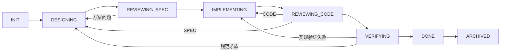

# OpenSpec 阶段工作流

## 入口和角色

从 [项目上下文](project-context.md) 确定当前请求、事实、约束和授权，再读取相关规范。使用 [本地 schema](../openspec/schemas/workflow-spec-driven/schema.yaml) 和 [项目技能](../.agents/skills/openspec-workflow/SKILL.md)。

## 角色

| 角色 | 定义 | 责任 |
|---|---|---|
| Coordinator | [coordinator](../.agents/roles/coordinator.md) | 范围、状态、授权和交付 |
| Designer | [designer](../.agents/roles/designer.md) | proposal、specs、design、tasks |
| Spec Reviewer | [spec-reviewer](../.agents/roles/spec-reviewer.md) | 可验证性与制品一致性 |
| Implementer | [implementer](../.agents/roles/implementer.md) | 实现、验证和任务进度 |
| Code Reviewer | [code-reviewer](../.agents/roles/code-reviewer.md) | 实际 diff、风险和测试证据 |
| Verifier / Archiver | [verifier-archiver](../.agents/roles/verifier-archiver.md) | 验收、规范同步与归档 |

默认由一个助手顺序承担。只有用户明确要求多 agent 时使用可用协作工具；角色不是自动运行配置。自审标为 SELF_REVIEW，独立审查说明实际审查者。

## 制品和状态

change 位于 openspec/changes/<change-name>/，名称使用 kebab-case。proposal 说明动机、范围、能力变化和验收；specs 定义可观察行为；design 记录实际现状与决定；tasks 包含可验证实施单元。

- INIT：核对真实工作区、规则、分支、相关 change、授权和本次必要工具；工具缺失只影响依赖它的工作。
- DESIGNING：proposal 先完成，specs / design 随后，tasks 依赖两者。只有与变更相关的决定才展开。
- REVIEWING_SPEC：核对范围、合同、验收、风险和任务映射；按实际请求判断是否还需要确认。
- IMPLEMENTING：逐个紧密关联单元实现，必要验证后勾选任务；不机械要求每项 TDD。
- REVIEWING_CODE：读取真实 diff 和运行证据，将问题路由到 CODE / SPEC / NEEDS_INPUT。
- VERIFYING：验证必要验收条件，确认任务完成、文档一致，无未解决阻断问题。
- DONE：实施及验收准备完成，可执行约定的交付动作。
- ARCHIVED：先同步已完成 delta 到 stable specs，再保存 change 到 archive/YYYY-MM-DD-<name>/；日期使用项目时区。

每次转换前重读 processing/status.md 和最新证据。缺少关键输入或必要检查时保留当前阶段，写清阻断项与续跑条件；只继续独立工作。

验收后的规范同步、归档、提交和推送是交付动作，不列为归档前必须勾选的任务，避免循环前置条件。推送失败不抹掉已完成的验收事实。

## 授权与审查

用户只要求方案时不实现；已要求范围明确的实现时连续推进，不为同一授权重复询问。新出现且影响范围的业务决定需具体输入；模板不授予任何远程写入、部署或消息发送权限。

问题包含编号、FAIL / WARN、CODE / SPEC / NEEDS_INPUT、文件行号、影响和处理结果。FAIL 有证据且阻断；WARN 可说明接受理由，不要求无意义的零建议。PASS 需要实际证据。

同一实质问题反复出现时重新检查根因与方案，避免重复无效修复。只有继续推进依赖用户决定或外部条件时才请求具体输入，并保留证据与续跑条件。用户明确暂停时保留当前状态。

## 过程记录

[过程模板](../openspec/schemas/workflow-spec-driven/templates/processing/) 包含 status、spec-review、code-review 和 verification。使用时填写真实内容，删除示例；CLI 不自动创建这些文件。

status 记录当前阶段、范围授权、待决定事项、审查方式、阻断项和转换表。审查报告记录轮次、证据与问题归属。verification 记录实际命令、退出码、PASS / FAIL / NOT_RUN 及验收映射。

模板中的示例和空字段不是确认、审查或完成证据；不得以文件存在推进状态。

## 验证与归档

Requirement 使用 SHALL / MUST，Scenario 使用四级标题及 WHEN / THEN。新增能力填写具体 Purpose；本版本 OpenSpec 1.14.1 的稳定规范校验要求至少 50 个字符。修改既有 Requirement 时带上完整新内容及场景，删除与改名明确迁移。

纯文档检查格式、引用和语义；代码执行目标项目必要测试与构建；外部协议、数据库或系统约束使用合适集成环境。未运行的必要检查保持 NOT_RUN。

CLI 可用时运行 schema / change 验证并读取 status / instructions。CLI 的 artifact 完成状态不等于实施、审查或用户确认完成。

缺少 CLI 时手动维护并说明边界。同步 delta 时保留无关规范，完整替换 MODIFIED，明确处理 REMOVED / RENAMED。没有行为变化时使用工具版本支持的纯文档模式，不虚构业务 spec。

归档前确认源和目标位于当前项目 changes 内，目标不存在；核对项目时区日期。CLI 使用不同日期时按确认后的项目日期安全调整目录并更新引用。

## Git 交付

仅在用户已授权时提交推送，使用当前项目约定分支和明确远程。提交前核对 diff、候选文件、忽略规则和远程进展；不强推、不夹带无关工作或私有资料。

成功报告实际 SHA 和结果；失败保留本地提交并解释原因。不要把包含本文件的 SHA 反复写回自身，避免递归提交。

## 模板维护

只把有证据、影响后续决策的经验写入 [lessons](lessons.md)。复制模板不继承原项目授权和业务约束。

模板文件按 [MIT 通知](workflow-kit-LICENSE) 使用，不更换目标项目根许可证。配置和格式遵循 [OpenSpec 官方文档](https://github.com/Fission-AI/OpenSpec/blob/main/docs/customization.md)。
